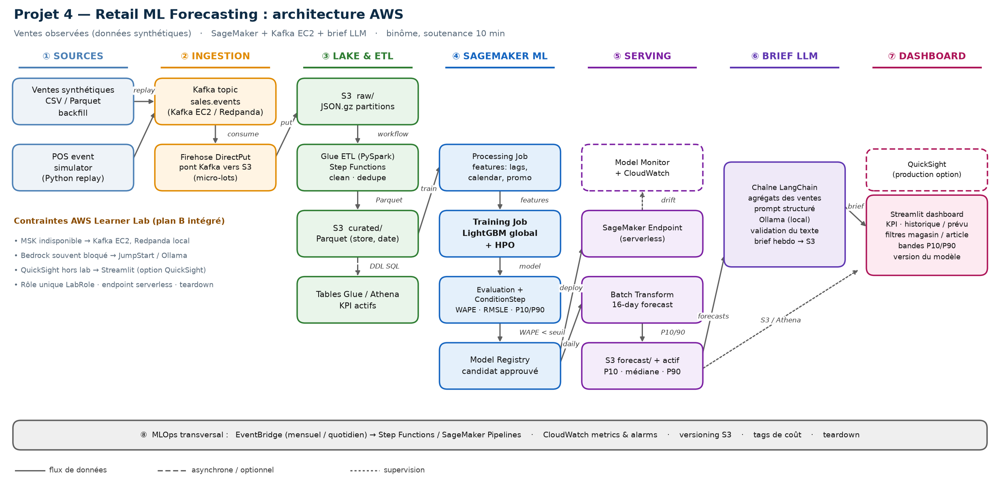

# Projet 4 — Retail ML Forecasting (MIT 2026)

Prédiction de la demande de produits : pipeline complet **Kafka/MSK → S3 → ETL →
SageMaker → prévisions → dashboard**, avec rapport LLM optionnel, selon le sujet n°4 du PDF
`1 Déroulement Cours Projet CL ML 2026.pdf` (« Données de ventes (S3/Kafka),
modèle de prévision dans SageMaker, dashboard dynamique »).



Diagramme détaillé et justifications : **[docs/architecture.md](docs/architecture.md)**.

**Revue du 19 novembre 2026 :** voir [docs/review.md](docs/review.md) pour les
écarts aux deux PDF, les corrections vérifiées et les limites restantes.
Évaluation AWS indépendante du code corrigé : **WAPE moyen 0,422609** contre
**0,559139** pour la baseline, sur les 16 horizons. Voir
[la preuve JSON](docs/evidence/aws_evaluation.json). Les autres anciennes métriques
ci-dessous précèdent la correction du split et de la baseline.

## État d'avancement

| Phase | Contenu | État |
|-------|---------|------|
| 0 | Squelette du repo, config, venv, tests | ✅ |
| 1 | Données : générateur synthétique (schéma compatible M5/Rossmann) | ✅ |
| 2 | Features + métriques + baseline LightGBM locale | ✅ |
| 3a | Ingestion Kafka → S3 (Redpanda + s3mock en local) | ✅ |
| 3b | ETL : nettoyage/dédup → `curated/` Parquet | ✅ Glue exécuté dans AWS |
| 4 | SageMaker : Processing / Training / évaluation / Registry / Batch | ✅ Évaluation, reprise contrôlée, publication AWS ; HPO et serverless optionnels non validés |
| 5 | Rapport LLM Ollama / SageMaker, sans agent autonome | Code présent ; service LLM requis |
| 6 | Dashboard Streamlit | ✅ Hébergé et testé sur le notebook AWS, données S3 actives |
| 7 | Rapport, vidéo 2 min, soutenance | ⏳ |

## Workflows AWS Learner Lab

Le parcours corrigé est décrit dans [docs/learner_lab_workflows.md](docs/learner_lab_workflows.md).
`make aws-workflows-up` déploie les workflows mensuel et quotidien, horaires
désactivés. Une première exécution de `retail-training` doit réussir avant
`retail-inference` : le modèle actif et ses prévisions sont publiés ensemble
dans `deployment/active.json`. Les 16 jours J+1 à J+16 sont tous prédits.
Le test réel EventBridge -> Glue -> inférence -> publication a réussi, en
conservant le modèle v6 : [preuves AWS](docs/evidence/aws_workflows.json).
Le notebook `retail-forecast-nb` héberge le dashboard (`/proxy/8501/` depuis
Jupyter). Les horaires récurrents restent désactivés.

## Démarrage rapide

```bash
make setup        # venv .venv + dépendances (CPU)
make env          # .env (S3 local par défaut)
make data         # 876 000 lignes -> data/raw/sales.parquet
make test         # tests locaux, sans Docker ni AWS
make train-quick  # LightGBM sur 20 % des séries (~3 s)
make train        # run complet (1 200 séries, ~40 s sur 11 cœurs)

make up           # Redpanda (Kafka) + console + s3mock (S3)  [docker]
make produce      # 5 000 ventes rejouées dans sales.events
make consume      # micro-lots gzip -> s3://retail-forecast-local/raw/sales/
make e2e          # tout enchaîner + vérifier les objets écrits
make down         # arrêter les conteneurs

make diagram      # régénère docs/diagrams/architecture.{png,svg}
make slides       # régénère docs/slides.pptx (exposé idée projet, 5 slides)
```

**Sous Windows** : `make` n'est pas installé par défaut et les venv utilisent
`.venv\Scripts\`. Utiliser `.\scripts\run.ps1 <tâche>` (PowerShell natif), Git Bash
ou WSL — voir [docs/windows.md](docs/windows.md). Le `Makefile` détecte l'OS tout
seul ; seuls les scripts `.sh` demandent bash.

## Ingestion (Phase 3) — la même API que sur AWS

```
data/raw/sales.parquet ──producer──> topic sales.events ──consumer──> S3 raw/
                                                                            └─ raw/sales/ingest_date=YYYY-MM-DD/batch-*.json.gz
```

| Rôle | Local (Docker) | AWS (Learner Lab) |
|------|----------------|-------------------|
| Bus d'événements | Redpanda `localhost:19092` | MSK ou Kinesis Data Streams |
| Buffer 60 s | consumer (flush par taille/temps) | Firehose |
| Stockage brut | s3mock `localhost:9090` | S3 |

Sémantique **at-least-once** : le commit Kafka n'a lieu qu'après l'écriture de
l'objet → un crash peut dupliquer un lot, l'ETL déduplique sur
`(store_id, item_id, date)`. Console Kafka : <http://localhost:8080>.

## Résultat historique (avant corrections, horizon 1 jour)

| Modèle | WAPE | RMSE |
|--------|------|------|
| Baseline « même jour de la semaine précédente » | 0.568 | 5.36 |
| **LightGBM global + features** | **0.430** | **4.03** |
| Gain | **−24,3 %** | −24,8 % |

Détail : 732 000 lignes d'entraînement, 67 200 de validation, 33 600 de test
(split temporel, dernier mois = test). Rapport machine :
`reports/local_baseline.json`.

## Structure

```
src/retail_forecast/
  config.py            # tout ce qui change entre local et Learner Lab (.env)
  data/simulate.py     # générateur de ventes (saisonnalité, promos, ruptures)
  features/build.py    # features anti-fuite + split temporel
  evaluate/metrics.py  # WAPE, MAPE, RMSE, pinball loss
  train/train_lgbm.py  # entraînement local = miroir du Training Job SageMaker
  ingest/ agent/       # ingestion et rapport LLM optionnel
infra/sagemaker/        # jobs, pipeline, registre et handler d'inférence
dashboards/streamlit/  # interface de consultation
tests/                 # tests sans service externe
docs/diagrams/         # architecture.py + .png + .svg
docs/architecture.md   # diagramme documenté, décisions, coûts, plan B
```

## Compte AWS (Learner Lab)

Le mode local utilise Redpanda + s3mock. Le parcours SageMaker, Athena et le
dashboard sont aussi déployés et validés dans le compte fourni par l'école : voir
**[docs/learner_lab.md](docs/learner_lab.md)** — enrôlement, démarrage de session,
récupération des identifiants dans le profil `lab`, bascule du `.env`, limites du lab
et réflexes qui protègent le crédit.

## Exposé « idée projet » (5 slides)

- **`docs/slides.pptx`** — prêt à présenter (16:9), généré par `make slides`
- **`docs/slides.md`** — même contenu en Markdown, à copier dans Canva / Google Slides
- **`docs/script.md`** — script parlé mot à mot pour les 3 diapositives de `pres.pdf` (+ questions du jury)

Plan : ① application et besoin · ② architecture AWS · ③ données et features ·
④ fonctionnalités et services · ⑤ preuve de faisabilité et planning.
Chaque slide a des notes d'orateur (onglet « Notes » dans PowerPoint).


## Diagrammes (5 versions, toutes générées par code)

| Version | Fichier | Usage |
|---------|---------|-------|
| Détaillée (8 étapes + notes) | `docs/diagrams/architecture.png` | rapport |
| Intermédiaire (16 blocs, icônes AWS) | `docs/diagrams/architecture_medium.png` | slide / oral |
| **Entraînement** (données → modèle → registre) | `docs/diagrams/architecture_training.png` | slide |
| **Inférence** (registre → prévisions → dashboard) | `docs/diagrams/architecture_inference.png` | slide |
| Simple (7 blocs) | `docs/diagrams/architecture_simple.png` | rappel 10 s |

`make diagram` régénère les cinq. Icônes officielles dans `docs/diagrams/icons/`.

## Choix structurants

1. **Un seul module de features** (`features/build.py`) utilisé en local, dans un
   Processing Job et dans Glue : pas de dérive entre dev et prod.
2. **Split temporel** et exclusion de `stock_on_hand` / `stockout` (fuites) :
   la question classique en soutenance est traitée d'avance.
3. **WAPE** comme métrique principale. La pinball loss est disponible, mais les
   quantiles P10/P90 ne sont pas encore entraînés ni livrés.
4. **Rapport LLM** via `ollama` ou `sagemaker` ; Bedrock n'est pas implémenté.

## Données

Par défaut : `retail_forecast.data.simulate` (aucun token requis, 2 ans × 20
magasins × 60 articles, ~3,6 % de ruptures). Pour utiliser un vrai jeu :

```bash
# Kaggle (M5 Walmart / Rossmann) : placer le CSV dans data/raw/ puis
.venv/bin/python -m retail_forecast.data.load --source data/raw/ventes.csv
```

Colonnes attendues : `date, store_id, item_id, category, unit_price, promo,
is_holiday, lead_time_days, stock_on_hand, stockout, units`.
Les lags et fenêtres utilisent les dates calendaires réelles. Les doublons
sont refusés ; un jour absent reste inconnu et ne devient pas une vente nulle.
