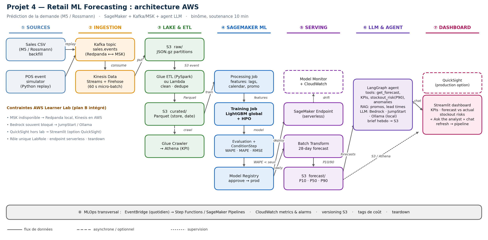

# Projet 4 — Retail ML Forecasting (MIT 2026)

Prédiction de la demande de produits : pipeline complet **Kafka/MSK → S3 → ETL →
SageMaker → agent LLM → dashboard**, conformément au sujet n°4 du PDF
`1 Déroulement Cours Projet CL ML 2026.pdf` (« Données de ventes (S3/Kafka),
modèle de prévision dans SageMaker, dashboard dynamique »).



Diagramme détaillé et justifications : **[docs/architecture.md](docs/architecture.md)**.

## État d'avancement

| Phase | Contenu | État |
|-------|---------|------|
| 0 | Squelette du repo, config, venv, tests | ✅ |
| 1 | Données : générateur synthétique (schéma compatible M5/Rossmann) | ✅ |
| 2 | Features + métriques + baseline LightGBM locale | ✅ |
| 3 | Ingestion Kafka → S3 → Glue (Redpanda/MinIO en local) | ⏳ |
| 4 | SageMaker : Processing / Training / HPO / Pipelines / Registry | ⏳ |
| 5 | Agent LLM LangGraph + RAG | ⏳ |
| 6 | Dashboard Streamlit | ⏳ |
| 7 | Rapport, vidéo 2 min, soutenance | ⏳ |

## Démarrage rapide

```bash
make setup        # venv .venv + dépendances (CPU)
make data         # 876 000 lignes -> data/raw/sales.parquet
make test         # 30 tests (features, métriques, générateur)
make train-quick  # LightGBM sur 20 % des séries (~3 s)
make train        # run complet (1 200 séries, ~40 s sur 11 cœurs)
make diagram      # régénère docs/diagrams/architecture.{png,svg}
```

## Résultat de référence (local, horizon 1 jour)

| Modèle | WAPE | RMSE |
|--------|------|------|
| Baseline « même jour de la semaine précédente » | 0.568 | 5.36 |
| **LightGBM global + features** | **0.430** | **4.03** |
| Gain | **−24,3 %** | −24,8 % |

Détail : 732 000 lignes d'entraînement, 67 200 de validation, 33 600 de test
(split temporel, dernier mois = test). Rapport machine :
`reports/local_baseline.json`.

## Structure

```
src/retail_forecast/
  config.py            # tout ce qui change entre local et Learner Lab (.env)
  data/simulate.py     # générateur de ventes (saisonnalité, promos, ruptures)
  features/build.py    # features anti-fuite + split temporel
  evaluate/metrics.py  # WAPE, MAPE, RMSE, pinball loss
  train/train_lgbm.py  # entraînement local = miroir du Training Job SageMaker
  ingest/ inference/ agent/   # phases 3, 5 (à venir)
tests/                 # 30 tests unitaires
docs/diagrams/         # architecture.py + .png + .svg
docs/architecture.md   # diagramme documenté, décisions, coûts, plan B
```

## Choix structurants

1. **Un seul module de features** (`features/build.py`) utilisé en local, dans un
   Processing Job et dans Glue : pas de dérive entre dev et prod.
2. **Split temporel** et exclusion de `stock_on_hand` / `stockout` (fuites) :
   la question classique en soutenance est traitée d'avance.
3. **WAPE** comme métrique principale (robuste aux ventes nulles) + **pinball
   loss** pour valider les quantiles P10/P90 utilisés dans le stock de sécurité.
4. **LLM pluggable** (`bedrock` | `jumpstart` | `ollama`) : le projet tourne même
   si Bedrock est inaccessible dans le Learner Lab.

## Données

Par défaut : `retail_forecast.data.simulate` (aucun token requis, 2 ans × 20
magasins × 60 articles, ~3,6 % de ruptures). Pour utiliser un vrai jeu :

```bash
# Kaggle (M5 Walmart / Rossmann) : placer le CSV dans data/raw/ puis
.venv/bin/python -m retail_forecast.data.simulate --help   # voir le schéma attendu
```

Colonnes attendues : `date, store_id, item_id, category, unit_price, promo,
is_holiday, lead_time_days, stock_on_hand, stockout, units`.
