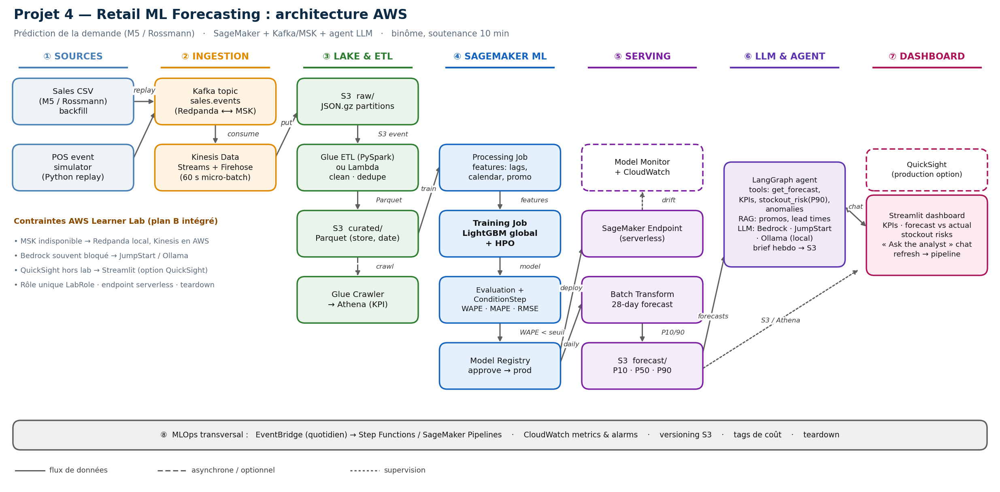
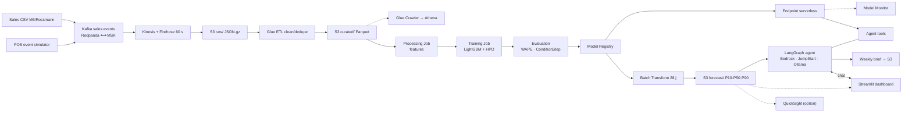

# Architecture — Projet 4 « Retail ML Forecasting »

> Livrable n°3 du rendu (« un diagramme d'architecture AWS clair et documenté »).
> Le diagramme est **généré par code** (donc versionnable et modifiable sans
> outil graphique) : source `docs/diagrams/architecture.py`, régénération avec
> `make diagram`.



Version vectorielle (rapport, zoom sans perte) : [`diagrams/architecture.svg`](diagrams/architecture.svg).

## 1. Les 8 étapes du pipeline

| # | Étape | Services | Rôle dans le projet |
|---|-------|----------|---------------------|
| ① | Sources | CSV M5 / Rossmann, simulateur d'événements POS | deux modes d'entrée : backfill historique et flux temps réel |
| ② | Ingestion | topic Kafka `sales.events` (**Redpanda** en local ⟷ **MSK** sur AWS), **Kinesis + Firehose** 60 s | bus d'événements, micro-batch vers le lac de données |
| ③ | Lake & ETL | **S3** `raw/` (JSON.gz) → **Glue ETL** PySpark / Lambda (clean, dédup, typage) → **S3** `curated/` (Parquet, partitionné store/date) → **Glue Crawler → Athena** | zone brute immuable + zone curée requêtable |
| ④ | SageMaker ML | **Processing Job** (features) → **Training Job** (LightGBM global) + **HPO** → **Evaluation / ConditionStep** (WAPE) → **Model Registry** | pipeline reproductible avec porte de qualité |
| ⑤ | Serving | **Endpoint serverless** (temps réel) · **Batch Transform** 28 j → `S3 forecast/` (P10/P50/P90) · **Model Monitor** | deux modes de consommation + surveillance de dérive |
| ⑥ | Agent LLM | **LangGraph**, LLM pluggable (**Bedrock** · JumpStart Llama-3 · **Ollama** local), outils `get_forecast` / KPIs / `stockout_risk` / anomalies, **RAG FAISS** (promos, lead times) | couche conversationnelle + brief hebdomadaire automatique |
| ⑦ | Dashboard | **Streamlit** (QuickSight en option « production ») | restitution métier : KPIs, prévu vs réalisé, risques, chat |
| ⑧ | MLOps transversal | **EventBridge** → **Step Functions / SageMaker Pipelines**, CloudWatch, versioning S3, tags de coût, teardown | industrialisation et maîtrise du budget |

## 2. Flux de données (le récit de la soutenance)

1. Le backfill historique est rejoué dans Kafka (ou chargé directement dans
   `S3 raw/` selon `INGEST_BACKEND`).
2. Kafka alimente Firehose, qui écrit des micro-lots JSON.gz dans `S3 raw/`.
3. Un événement S3 déclenche le job Glue : nettoyage, déduplication, typage →
   `S3 curated/` en Parquet, catalogué par Glue Crawler (requêtable dans Athena).
4. `S3 curated/` est la source du **Processing Job** qui calcule les features
   (lags, moyennes glissantes, calendrier, promos).
5. Le **Training Job** apprend un modèle global LightGBM ; l'**HPO** règle les
   hyperparamètres ; l'étape d'évaluation bloque le pipeline si le WAPE dépasse
   le seuil (`WAPE_THRESHOLD=0.30`).
6. Le modèle approuvé dans le **Model Registry** est déployé sur un endpoint
   serverless *et* exécuté en Batch Transform quotidien pour produire 28 jours
   de prévisions quantiles dans `S3 forecast/`.
7. L'**agent LangGraph** lit ces prévisions (S3/Athena + endpoint) et les
   documents (promos, lead times) pour répondre aux questions et rédiger le
   brief hebdomadaire.
8. Le **dashboard Streamlit** affiche KPIs, prévu vs réalisé, risques de rupture
   et le chat « Ask the analyst » ; le bouton *refresh* déclenche le pipeline.

## 3. Décisions de modélisation

| Sujet | Choix | Justification |
|-------|-------|---------------|
| Cible | `units[t + h]`, h = 1…28 (direct multi-horizon) | un modèle par horizon évite la propagation d'erreur du récursif |
| Modèle | LightGBM **global** (toutes séries), `log1p` optionnel | 1 200 séries × 730 j : un modèle global bat des Prophet par série sur un budget Learner Lab |
| Baseline | « même jour de la semaine précédente » (`lag_7`), puis Prophet | obligatoire pour prouver l'apport : **−24,3 % de WAPE** en local |
| Features | lags 1/7/14/21/28/35, moyennes & écarts-types glissants 7/14/28, `dow`, `week`, `month`, `is_weekend`, `is_holiday`, `promo`, prix, `price_x_promo`, `lead_time_days` | couvre tendance, saisonnalité, effet promo et structure magasin/article |
| Anti-fuite | `stock_on_hand` et `stockout` **exclus** ; split **temporel** | ce sont des conséquences de la demande (censoring) |
| Métriques | **WAPE** (principale), RMSE, MAPE (hors zéros), **pinball loss** P10/P50/P90 | WAPE reste défini avec des ventes nulles ; le pinball valide les quantiles utilisés pour le stock de sécurité |
| HPO | SageMaker Automatic Model Tuning : `num_leaves`, `learning_rate`, `min_child_samples`, `feature_fraction`, `n_estimators` | 10 essais max, `max_runtime_in_seconds` borné pour le coût |

Hyperparamètres de départ (identiques en local et dans le Training Job) :
`learning_rate=0.05`, `num_leaves=63`, `min_child_samples=40`,
`subsample=0.8` (`subsample_freq=1`), `colsample_bytree=0.8`, `reg_lambda=1.0`,
`n_estimators=600` avec early stopping (patience 50).

## 4. Agent LLM

* **Graph** : `plan → tool call → validate → compose` (LangGraph, mémoire
  `SqliteSaver`).
* **Outils** exposés : `get_forecast(store, item, horizon)`, `get_kpis(period)`,
  `top_movers(n)`, `stockout_risk()` (P90 > stock), `explain_anomaly(residuals)`,
  `rag_lookup(question)`.
* **LLM pluggable** via `LLM_PROVIDER` : `bedrock` (Claude 3 Haiku), `jumpstart`
  (Llama-3 sur endpoint SageMaker), `ollama` (local, gratuit) — même graphe,
  aucune réécriture.
* **Sortie structurée** : brief hebdomadaire JSON + Markdown déposé dans S3 et
  affiché dans le dashboard.

## 5. Contraintes AWS Learner Lab et plan B

| Contrainte | Impact | Plan B intégré |
|-----------|--------|----------------|
| MSK non autorisé / coûteux | pas de Kafka managé | Redpanda en Docker en local, **Kinesis + Firehose** côté AWS |
| Bedrock souvent inaccessible | pas de Claude | **JumpStart Llama-3** sur SageMaker ou **Ollama** local |
| QuickSight absent du lab | pas de BI managée | **Streamlit** (QuickSight documenté comme option production) |
| `iam:CreateRole` interdit | pas de rôle custom | tout passe par `LabRole` (`SAGEMAKER_ROLE_ARN`) |
| Crédits limités, credentials ~4 h | risque de coupure | endpoint **serverless**, `scripts/teardown.sh`, `max_runtime_in_seconds` |

Ordre de grandeur du coût d'une démonstration complète : Studio `ml.m5.large`
≈ 0,12 $/h, Training ≈ 0,02 $ par run, HPO 10 essais ≈ 0,5 $, endpoint
serverless à la requête, S3/Glue quelques centimes → **< 5 $ au total**, très
en dessous du crédit Learner Lab.

## 6. Source Mermaid (rendu GitHub / VS Code)



## 7. Régénérer le diagramme

```bash
make diagram          # ou : python3 docs/diagrams/architecture.py
```

Le script ne dépend que de `matplotlib` ; il écrit `architecture.png` (190 dpi)
et `architecture.svg` dans `docs/diagrams/`.

