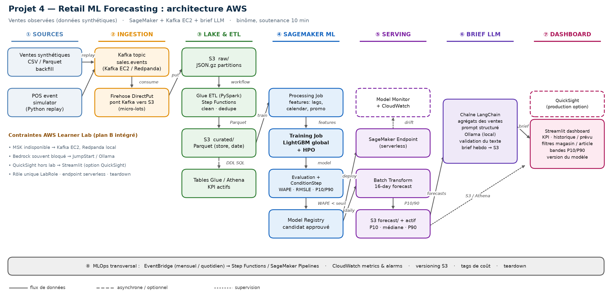
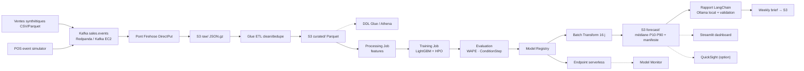

# Architecture — Projet 4 « Retail ML Forecasting »

> Livrable n°3 du rendu (« un diagramme d'architecture AWS clair et documenté »).
> Le diagramme est **généré par code** (donc versionnable et modifiable sans
> outil graphique) : source `docs/diagrams/architecture.py`, régénération avec
> `make diagram`.



Version vectorielle (rapport, zoom sans perte) : [`diagrams/architecture.svg`](diagrams/architecture.svg).

État réellement exécuté et preuves : [rapport final](rapport_final.md) et
[validation du 26 novembre](evidence/completion_2026-11-26.json).
Model Monitor et QuickSight restent des options de la cible, non démontrées.

## 1. Les 8 étapes du pipeline

| # | Étape | Services | Rôle dans le projet |
|---|-------|----------|---------------------|
| ① | Sources | ventes synthétiques CSV/Parquet, simulateur POS | deux modes d'entrée : backfill historique et flux temps réel |
| ② | Ingestion | topic Kafka `sales.events` (**Redpanda** en local, **Kafka EC2** sur AWS), pont **Firehose DirectPut** | bus d'événements, micro-batch vers le lac de données |
| ③ | Lake & ETL | **S3** `raw/` (JSON.gz) → **Glue ETL** PySpark via Step Functions (clean, dédup, typage) → **S3** `curated/` (Parquet, partitionné store/date) → **DDL Glue/Athena** | zone brute immuable + zone curée requêtable |
| ④ | SageMaker ML | **Processing Job** (features) → **Training Job** (LightGBM global) + **HPO** → **Evaluation / ConditionStep** (WAPE) → **Model Registry** | pipeline reproductible avec porte de qualité |
| ⑤ | Serving | **Endpoint serverless** (temps réel) · **Batch Transform** 16 j → `S3 forecast/` (médiane et P10/P90) · **Model Monitor optionnel** | deux modes de consommation ; surveillance optionnelle |
| ⑥ | Rapport LLM | **LangChain LCEL + Ollama local** : agrégats, prompt, schéma JSON et validation | brief optionnel ; faits vérifiés et recommandations autorisées, sans agent ni RAG |
| ⑦ | Dashboard | **Streamlit** (QuickSight en option « production ») | restitution métier : KPI, historique, prévisions et P10/P90 |
| ⑧ | MLOps transversal | **EventBridge** → **Step Functions / SageMaker Pipelines**, CloudWatch, versioning S3, tags de coût, teardown | industrialisation et maîtrise du budget |

## 2. Flux de données (le récit de la soutenance)

1. Le backfill historique est rejoué dans Kafka (ou chargé directement dans
   `S3 raw/` selon `INGEST_BACKEND`).
2. Kafka alimente Firehose, qui écrit des micro-lots JSON.gz dans `S3 raw/`.
3. Step Functions déclenche le job Glue : nettoyage, déduplication, typage →
   `S3 curated/` en Parquet, catalogué par DDL SQL (requêtable dans Athena).
4. `S3 curated/` est la source du **Processing Job** qui calcule les features
   (lags, moyennes glissantes, calendrier, promos).
5. Le **Training Job** apprend un modèle global LightGBM ; l'**HPO** règle les
   hyperparamètres ; l'étape d'évaluation bloque le pipeline si le WAPE dépasse
   le seuil (`WAPE_THRESHOLD=0.45`). Le HPO exploratoire sur J+1 optimise valid_wape et ne remplace pas automatiquement la référence.
6. Le modèle actif désigné par le manifeste est déployé sur un endpoint
   serverless *et* exécuté en Batch Transform quotidien pour produire 16 jours
   de prévisions quantiles dans `S3 forecast/`.
7. La chaîne **LangChain/Ollama** lit les prévisions actives et leurs métriques,
   recopie des faits calculés et choisit deux recommandations autorisées.
   Le texte est validé avant sa sauvegarde dans S3 ; il n'y a pas d'agent autonome.
8. Le **dashboard Streamlit** consulte le manifeste actif et affiche l'historique,
   les prévisions, les quantiles et des filtres. Il ne déclenche pas de réentraînement.

## 3. Décisions de modélisation

| Sujet | Choix | Justification |
|-------|-------|---------------|
| Cible | `units[t + h]`, h = 1…16 (direct multi-horizon) | un modèle par horizon évite la propagation d'erreur du récursif |
| Modèle | LightGBM **global** (catalogue actif), médiane et quantiles | Profil `median_calendar_v1` : objectif quantile alpha 0,5, aligné sur l'erreur absolue ; anciens artefacts L2 compatibles |
| Baseline | dernière date disponible du même jour de semaine que la cible | obligatoire pour prouver l'apport : **−24,3 % de WAPE** en local |
| Features | lags 1/7/14/21/28/35, rolling 7/14/28, calendrier origine, promo/prix connus, calendrier cible enrichi (fériés, week-end, limites du mois, cycles annuels) | [Contrat versionné commun au train et au serving](median_production.md), sans prix ni promotion futur observé |
| Anti-fuite | `stock_on_hand` et `stockout` **exclus** ; split **temporel purgé**, dates manquantes inconnues | ce sont des conséquences de la demande (censoring) |
| Métriques | **WAPE** (principale), RMSE, RMSLE, MAPE (hors zéros), pinball P10/P90 et couverture | WAPE reste défini avec des ventes nulles ; le pinball et la couverture évaluent les quantiles, sans garantir une politique de stock |
| HPO | SageMaker Automatic Model Tuning : `num_leaves`, `learning_rate`, `n_estimators` | 6 essais sur J+1, objectif valid_wape ; durée bornée |

Hyperparamètres de départ (identiques en local et dans le Training Job) :
`learning_rate=0.05`, `num_leaves=63`, `min_child_samples=40`,
`subsample=0.8` (`subsample_freq=1`), `colsample_bytree=0.8`, `reg_lambda=1.0`,
`n_estimators=400` avec early stopping (patience 40).

## 4. Rapport LLM optionnel

La chaîne LCEL est `agrégations → PromptTemplate → Ollama → validation`.
Le backend validé est `qwen2.5:3b` local, avec des prévisions AWS lues depuis
le manifeste. Le JSON impose trois faits vérifiés recopiés et deux recommandations
différentes choisies dans une liste autorisée. Le texte Markdown validé est sauvegardé
localement et dans S3. Aucun outil autonome, mémoire conversationnelle ou RAG
n'intervient ; la prévision fonctionne sans LLM. Les recommandations restent à
examiner par un responsable métier.

## 5. Contraintes AWS Learner Lab et plan B

| Contrainte | Impact | Plan B intégré |
|-----------|--------|----------------|
| MSK non autorisé / coûteux | pas de Kafka managé | Redpanda en Docker en local, **Kafka EC2 + pont Firehose DirectPut** côté AWS |
| Bedrock souvent inaccessible | pas de Claude | **JumpStart Llama-3** sur SageMaker ou **Ollama** local |
| QuickSight absent du lab | pas de BI managée | **Streamlit** (QuickSight documenté comme option production) |
| `iam:CreateRole` interdit | pas de rôle custom | tout passe par `LabRole` (`SAGEMAKER_ROLE_ARN`) |
| Crédits limités, credentials ~4 h | risque de coupure | endpoint **serverless**, `scripts/teardown.sh`, `max_runtime_in_seconds` |

Le coût dépend des durées réelles de Glue, Processing, Training, HPO et du notebook.
Aucun total non mesuré n'est promis. Les horaires sont désactivés, le notebook est
arrêté et l'endpoint de test supprimé après validation ; S3 et le disque conservé
peuvent continuer à être facturés.

## 6. Source Mermaid (rendu GitHub / VS Code)



## 7. Régénérer le diagramme

```bash
make diagram          # ou : python3 docs/diagrams/architecture.py
```

Le script ne dépend que de `matplotlib` ; il écrit `architecture.png` (190 dpi)
et `architecture.svg` dans `docs/diagrams/`.

## 8. Équivalents locaux (développement sans AWS)

Le code ne change pas : seules les variables d'environnement changent.

| Brique | AWS | Local (Docker) | Variable |
|--------|-----|----------------|----------|
| Bus d'événements | Kafka EC2 | **Redpanda** (`:19092`) | `KAFKA_BOOTSTRAP` |
| Buffer micro-lot | Firehose | consumer (flush taille/temps) | `--batch-size`, `--flush-seconds` |
| Stockage objet | S3 | **s3mock** (`:9090`) | `S3_ENDPOINT_URL` |
| ETL | Glue (PySpark) | pandas (`etl/build_curated.py`) | — |
| Entraînement | SageMaker Training | LightGBM local | — |
| LLM | Ollama local lisant les prévisions S3 | Ollama | `LLM_PROVIDER` |

Vérifié de bout en bout : 2 000 événements → 4 objets gzip de 500 messages dans
`s3://retail-forecast-local/raw/sales/ingest_date=…/` (`make e2e`).


