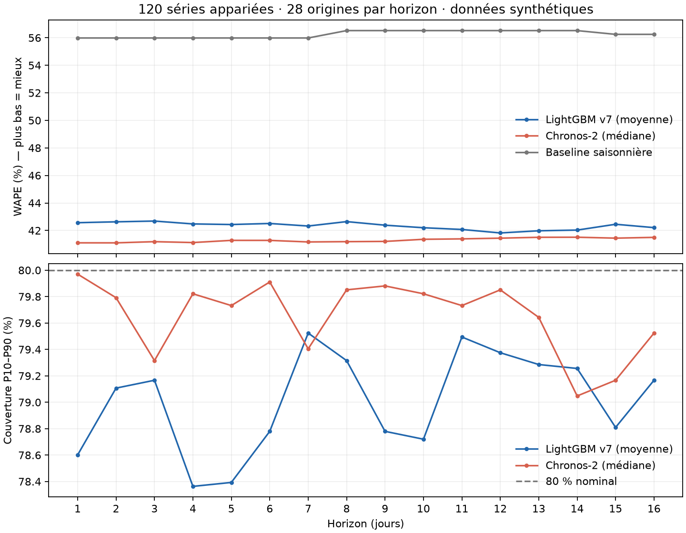

# Comparaison Chronos-2 / LightGBM

Cette expérience ne modifie ni le registre, ni `deployment/active.json`, ni les
prévisions du dashboard. Chronos-2 est évalué sans fine-tuning.

## Protocole

- Modèle : `amazon/chronos-2`, révision figée
  `29ec3766d36d6f73f0696f85560a422f50e8498c`, bibliothèque `chronos-forecasting==2.3.2`.
- Référence : les poids du modèle LightGBM actif v7, rechargés sans entraînement.
- Données : le même historique synthétique de 876 000 lignes.
- Échantillon : 120 séries, sélectionnées par hachage des identifiants, à raison
  de six par magasin. Aucun résultat de vente n'intervient dans cette sélection.
- Les deux modèles sont comparés sur les mêmes lignes : 28 origines par horizon,
  16 horizons, soit 53 760 couples série/origine/cible. La réunion des origines
  contient 43 dates, car les fenêtres de test sont décalées par horizon.
- Chronos utilise 256 jours de contexte et des covariables calendaires connues à
  l'origine : jour de semaine, mois, jour du mois et jours fériés du simulateur.
  Aucune vente, rupture, promotion observée ou prix observé après l'origine
  n'est fourni. Les jours manquants ne sont pas imputés à zéro.
- `cross_learning=False`, CPU float32, quatre threads, batch de 128 canaux.
- La sortie ponctuelle native de Chronos est une **médiane P50** ; la référence
  LightGBM est une régression de moyenne. Le WAPE permet de comparer leurs
  erreurs ponctuelles, sans confondre ces deux statistiques.
- P10/P90 : écrêtage à zéro et remise en ordre identiques pour les deux modèles.
  Mesures : WAPE moyen des horizons, RMSLE, couverture et pinball loss.

La réévaluation locale de LightGBM sur l'ensemble des 1 200 séries donne environ
0,422610 de WAPE, contre 0,422609 arrondi dans la preuve AWS. L'écart numérique
minuscule ne constitue pas un réentraînement. La conclusion du benchmark utilise
exclusivement les scores recalculés sur les **mêmes 120 séries**, pas ce score global.

La petite sonde initiale à 32 séries/deux origines a servi à vérifier l'API et le
temps de calcul ; elle ne constitue pas le résultat final. Les quotas GPU Processing
`ml.g4dn.xlarge` et `ml.g5.xlarge` du lab sont nuls. Aucun calcul AWS n'est lancé
pour cette comparaison locale.

## Reproduction

Installer d'abord PyTorch CPU pour éviter les dépendances CUDA sur ce poste :

```bash
.venv/bin/python -m pip install 'torch>=2.2,<3' --index-url https://download.pytorch.org/whl/cpu
.venv/bin/python -m pip install -e '.[benchmark]'
```

Le benchmark attend `data/raw/sales.parquet` et une copie de l'artefact actif
sous `data/benchmark/active-model.tar.gz`. Le premier est généré par `make data` ;
le second se télécharge avec les credentials du lab, sans démarrer de job :

```python
import json
from retail_forecast.config import SETTINGS
from retail_forecast.ingest.storage import s3_client
from pathlib import Path

s3 = s3_client()
active = json.loads(s3.get_object(Bucket=SETTINGS.bucket, Key='deployment/active.json')['Body'].read())
bucket, key = active['model_data_url'].removeprefix('s3://').split('/', 1)
Path('data/benchmark').mkdir(parents=True, exist_ok=True)
s3.download_file(bucket, key, 'data/benchmark/active-model.tar.gz')
Path('data/benchmark/active.json').write_text(json.dumps(active))
```

Puis lancer `make benchmark-chronos`. Le téléchargement des poids publics est
figé à la révision indiquée. `--model-path /chemin/vers/les/poids` permet d'utiliser
une copie locale de cette même révision. `--series-limit 0` étend le calcul à
l'ensemble des séries ; ce calcul est sensiblement plus long sur CPU.

Les checkpoints et modèles restent dans `data/benchmark/`, ignoré par Git.
Le JSON final est `reports/chronos2_benchmark.json`. La synthèse et le graphique
se régénèrent avec `.venv/bin/python docs/build_chronos_report.py --weights /chemin/model.safetensors`
(les poids doivent être ceux de la révision figée). Les tests de protocole
ne chargent pas Chronos et n'appellent aucun service.

Cette comparaison est exploratoire, sur un sous-ensemble et des données
synthétiques. Elle ne prouve ni un classement sur toutes les séries ni une
performance commerciale sur des ventes réelles. Les résultats ne doivent pas
servir à optimiser répétitivement le même test avant de revendiquer une nouvelle
performance indépendante.

Références : [code officiel Chronos](https://github.com/amazon-science/chronos-forecasting),
[fiche du modèle](https://huggingface.co/amazon/chronos-2).

## Résultat exécuté

| Mesure | LightGBM v7 | Chronos-2 |
|---|---:|---:|
| WAPE moyen | 42.34% | 41.30% |
| RMSLE moyen | 0.5381 | 0.5213 |
| Couverture P10/P90 | 79.01% | 79.65% |

Baseline saisonnière sur ces mêmes observations : **56.25%** de WAPE.
Écart relatif de WAPE de Chronos-2 face à LightGBM : **-2.45%** (un signe négatif signifie moins d’erreur). Le modèle actif n’a pas été remplacé. Une validation sur les 1 200 séries et une intégration AWS restent nécessaires avant son remplacement.

Les 120 séries couvrent 20 magasins et 48 articles distincts.
Temps cumulé d’inférence Chronos sur les 43 origines : 14.8 minutes,
sur cpu, avec 4 threads. Ce temps ne correspond pas à une seule prévision de 16 jours.

Écart de WAPE, intervalle bootstrap descriptif à 95 % : -1.62 à -0.45 points. Rééchantillonnage de séries entières ; les corrélations entre séries ne sont pas toutes représentées.



Preuve détaillée : [JSON du benchmark](../reports/chronos2_benchmark.json).
