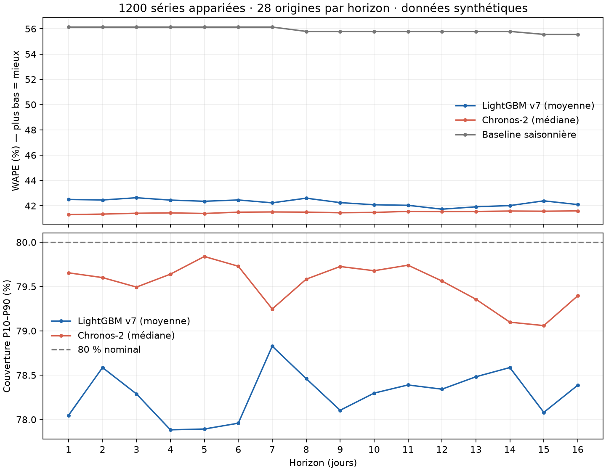

# Chronos-2 — catalogue complet et validation AWS

Cette validation complète le [pilote à 120 séries](chronos_benchmark.md).
Elle conserve le modèle actif v7 : aucune écriture dans `deployment/active.json`,
aucun changement de calendrier EventBridge, aucune approbation de registre.

## Périmètre et protocole

- **1 200 séries**, 20 magasins × 60 articles, même historique synthétique.
- **16 horizons**, 28 origines évaluables par horizon : **537 600 couples appariés**.
- Les 43 dates d'origine sont réparties sans chevauchement sur six jobs
  SageMaker `ml.m5.xlarge`, avec un plafond d'une heure par job.
- Chaque job traite toutes les séries, avec les mêmes données et les mêmes
  poids Chronos-2 figés à la révision du pilote. Il n'y a pas de fine-tuning.
- Les métriques globales sont recalculées localement à partir des prédictions
  brutes AWS, sur le panel LightGBM complet. Les moyennes des partitions ne
  sont pas moyennées naïvement : les nombres de cibles diffèrent par partition.
- Même contexte de 256 jours, même calendrier connu et mêmes quantiles que
  le pilote ; `cross_learning=False`, CPU float32, batch de 128 canaux.
- La référence prédit une moyenne, Chronos une médiane. Les représentations
  calendaires diffèrent : Chronos reçoit notamment l'indicateur férié futur
  déterministe, tandis que LightGBM représente les dates cibles par jour/mois.
  Le gain éventuel ne peut donc pas être attribué au seul préentraînement.

Les quotas GPU affichés ne suffisent pas : IAM a refusé le lancement GPU et les
plus grosses instances CPU essayées. Le type documenté `ml.m5.xlarge` a été
accepté. Aucune politique IAM n'a été modifiée. Le calcul local de secours a
été interrompu après vérification de la progression des six jobs AWS.

## Validation du serving

La partition 0 prépare aussi les poids et le code dans un `model.tar.gz` standard.
Son handler sert 32 historiques complets par requête et refuse les dates
manquantes, valeurs non finies, identifiants dupliqués et sorties incohérentes.

Un vrai **SageMaker Batch Transform CPU** charge cet artefact et produit les
**19 200 prévisions** du catalogue courant. Le contrôle indépendant exige :

1. 1 200 séries × les 16 horizons, aucune perte ni doublon.
2. Origine commune et cible exactement égale à origine + horizon.
3. Valeurs finies, non négatives et P10 ≤ médiane ≤ P90.
4. Accord avec la référence d'inférence évaluée, à une tolérance numérique
   relative et absolue de 0,001 entre les exécutions CPU.
5. Manifeste actif inchangé ; candidat conservé dans le préfixe du benchmark.

Le résultat Batch Transform est distinct d'un endpoint permanent et d'une
intégration aux workflows mensuel/quotidien de production. Ceux-ci restent sur v7.
Les jobs terminés ne conservent pas d'instance ; le modèle de test est supprimé
après validation. Les données et artefacts S3 restent disponibles.

## Reproduction

Après installation des dépendances du benchmark et configuration du lab :

```bash
# Utiliser le même run-id pour les six partitions ; en choisir un neuf à chaque expérience.
for shard in 0 1 2 3 4 5; do
  .venv/bin/python -m infra.sagemaker.chronos_benchmark start \
    --instance ml.m5.xlarge --origin-shards 6 --origin-shard "$shard" --run-id mon-run-id
 done
.venv/bin/python -m infra.sagemaker.chronos_validate run
```

Cette commande démarre six jobs CPU ; leurs limites de durée sont explicites.
La surveillance arrête les autres jobs de l'expérience si une partition échoue.
Une reprise réutilise les sorties terminées et le Batch Transform déjà créé.
Les checkpoints et archives téléchargées restent sous `data/benchmark/`, ignoré
par Git. Les preuves de jobs sont sous `docs/evidence/chronos_full_aws_s*.json` ;
la preuve du serving est `docs/evidence/chronos_transform_aws.json`.

La synthèse se génère depuis le résultat complet :

```bash
.venv/bin/python docs/build_chronos_report.py \
  --report reports/chronos2_full_benchmark.json \
  --doc docs/chronos_full_validation.md \
  --figure reports/chronos2_full_by_horizon.png \
  --weights /chemin/vers/les/poids/model.safetensors
```

Les chiffres des anciens rendus décrivent v7 et restent historiques. Ce test
sur données synthétiques ne remplace pas une validation sur des ventes réelles.

## Preuve AWS finale

Les six jobs ont terminé avec succès et le vrai Batch Transform a été vérifié :
**19 200 lignes**, **1 200 séries**, **16 horizons**. L’écart maximal entre le
serving et l’inférence évaluée est de **0,000031 unité** sur les valeurs et quantiles.
Le modèle temporaire a été supprimé ; aucun job du projet n’est resté actif,
le notebook est arrêté et les horaires sont désactivés. Le manifeste v7 est inchangé.

- [Preuve Batch Transform](evidence/chronos_transform_aws.json).
- [Vérification de nettoyage](evidence/chronos_full_cleanup.json).
- [Rapport complet et identifiants des six jobs](../reports/chronos2_full_benchmark.json).

Ce candidat n’a pas été activé dans les workflows de production spécifiques à
LightGBM. Le Batch Transform prouve son exécution sur AWS ; ce n’est pas un test
d’endpoint serverless ni une promotion de registre.

## Résultat exécuté

| Mesure | LightGBM v7 | Chronos-2 |
|---|---:|---:|
| WAPE moyen | 42.26% | 41.48% |
| RMSLE moyen | 0.5384 | 0.5208 |
| Couverture P10/P90 | 78.29% | 79.53% |

Baseline saisonnière sur ces mêmes observations : **55.91%** de WAPE.
Écart relatif de WAPE de Chronos-2 face à LightGBM : **-1.85%** (un signe négatif signifie moins d’erreur). Le modèle actif n’a pas été remplacé. Le résultat reste propre au jeu synthétique ; la publication active est un parcours distinct.

Les 1200 séries couvrent 20 magasins et 60 articles distincts.
Temps cumulé d’inférence Chronos sur les 43 origines : 95.0 minutes,
sur cpu, avec 4 threads par processus. Il s’agit du temps cumulé, pas du délai d’une seule prévision de 16 jours.

Écart de WAPE, intervalle bootstrap descriptif à 95 % : -0.99 à -0.57 points. Rééchantillonnage de séries entières ; les corrélations entre séries ne sont pas toutes représentées.



Preuve détaillée : [JSON du benchmark](../reports/chronos2_full_benchmark.json).
