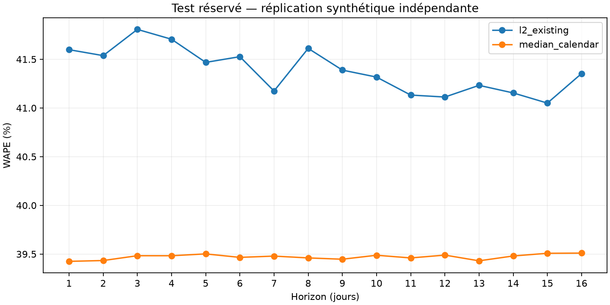

# LightGBM : erreur absolue et calendrier cible

Expérience locale complète, sans appel AWS ni modification du modèle actif v7.

## Protocole fixé avant l'évaluation

Réplication synthétique indépendante : seed **20261126**, 20 magasins × 60 articles × 730 jours, même simulateur, bruit et ruptures que le jeu initial. Les niveaux latents des articles/magasins changent : tous les modèles, y compris le témoin L2, sont réentraînés sur cette réplication. Ce résultat ne remplace pas les scores v7/Chronos obtenus sur l'ancien jeu.

Validation à partir du **2024-10-08** ; test réservé : cibles du **2024-12-03 au 2024-12-30**, soit 28 jours communs aux 16 horizons. Les cibles sont purgées aux frontières. Les deux blocs chronologiques de validation sont conservés dans le JSON.

Cinq variantes préfixées ; sélection par moyenne des WAPE de validation des 16 horizons. Le test n'est calculé que pour le témoin et la variante sélectionnée, après enregistrement du choix. Les itérations sont choisies par early stopping L1 sur la validation (400 arbres maximum, patience 40), mêmes paramètres structurels et seed 42.

Calendrier supplémentaire : jours fériés du simulateur, week-end, début/fin de mois, sinus/cosinus annuels et semi-annuels de la date cible. Aucun prix, promotion, stock ou volume futur observé. Le calendrier métier doit être remplacé pour des données réelles.

## Sélection sur la validation

| Variante | WAPE validation | Bloc 1 | Bloc 2 |
|---|---:|---:|---:|
| l2_existing | 40.5082% | 40.6622% | 40.2631% |
| l1_existing | 40.2269% | 40.3635% | 40.0006% |
| l2_calendar | 40.3873% | 40.5590% | 40.1459% |
| l1_calendar | 40.0786% | 40.2175% | 39.8797% |
| median_calendar | 40.0782% | 40.2156% | 39.8821% |

Variante retenue avant ouverture du test : **median_calendar**. Les scores L1 et quantile médian avec calendrier sont pratiquement identiques sur la validation ; leur faible écart ne démontre pas une supériorité de l'une sur l'autre.

## Test réservé

| Modèle | WAPE moyen | RMSLE moyen |
|---|---:|---:|
| l2_existing | 41.3857% | 0.533710 |
| median_calendar | 39.4716% | 0.507850 |

Variation relative favorable du WAPE : **4.63 %**. Une WAPE plus basse est préférable. Il ne s'agit pas d'un taux d'exactitude.

Le candidat améliore 16 horizons sur 16, sur 537 600 couples évalués. Le RMSLE est également indiqué pour vérifier que le gain n'est pas limité à une seule métrique.



## Limites et reproduction

Une seule réplication synthétique ; pas de preuve sur données réelles, pas de nouvelle exécution AWS, pas de quantiles P10/P90 pour ce candidat. Les features sont optionnelles et le pipeline de production conserve son comportement. Une promotion demanderait un artefact complet avec intervalles et l'évaluation AWS indépendante.

```bash
make benchmark-median
.venv/bin/python docs/build_median_report.py
```

Le cache local `data/benchmark/median-calendar/` contient protocole préalable, choix figé, 80 modèles et prédictions. Les données/modèles ne sont pas versionnés. Les mesures complètes sont dans `reports/median_calendar_benchmark.json`.

## Diagnostic secondaire sur le jeu du projet

Après gel du candidat, réentraînement sur le jeu d'origine, avec les mêmes frontières et paramètres que v7 (sauf objectif et calendrier). Appariement exact des 537 600 couples évalués aux prédictions du véritable artefact v7. Ce test a déjà été consulté : ces chiffres sont descriptifs et ne servent pas à choisir le modèle.

| Modèle | WAPE moyen | RMSLE moyen |
|---|---:|---:|
| v7 déployé | 42.2610% | 0.538387 |
| median_calendar, candidat local | 40.4560% | 0.513387 |

```bash
.venv/bin/python -m retail_forecast.evaluate.median_project_check
.venv/bin/python docs/build_median_report.py
```

Ce diagnostic exige `data/raw/sales.parquet` et l'artefact v7 exact dans `data/benchmark/active-model.tar.gz`, absents de Git. Leurs SHA-256 sont conservés dans `reports/median_project_diagnostic.json`. Le benchmark principal génère lui-même sa réplication et n'exige pas ces fichiers.

Le benchmark Chronos-2 existant, sur ces mêmes données et cette même référence v7, avait donné **41.4794%** de WAPE. Le candidat médian est donc aussi inférieur sur ce diagnostic descriptif. Chronos n'a pas été évalué sur la nouvelle réplication indépendante.
